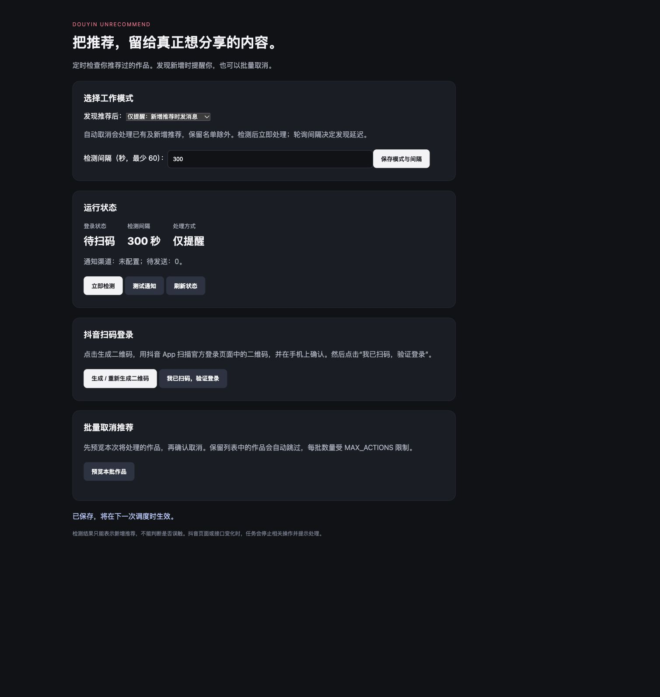
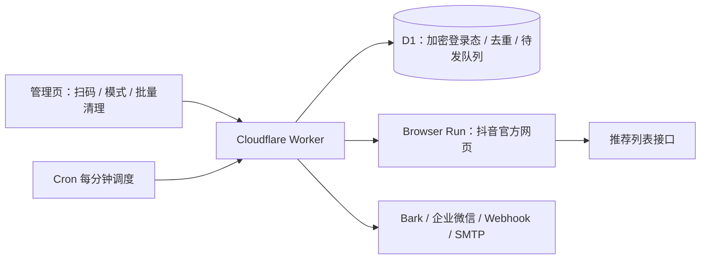

# 抖音推荐防误触

发现自己不小心点了「推荐」？这个工具定时读取**个人主页 → 推荐**，支持发消息提醒，也支持检测后自动取消。

**纯 Cloudflare 部署，无需自备服务器；也可在普通服务器或 Docker 中运行。中文界面、中文文档，MIT 开源。**



> v0.1 是需要实际账号验收的初始版本。已在真实 Chrome 中确认推荐列表接口及空列表响应，并在本地服务验证官方二维码页面加载和模式切换；当前测试账号没有推荐记录，因此**真实非空列表分页、真实取消控件、扫码后的登录态恢复及 Cloudflare 出口网络尚未端到端验证**。自动化测试使用模拟页面与接口。建议先使用「仅提醒」模式，再用一条你确实想取消的记录验收取消功能。未匹配明确控件时程序报错停止，不会猜测点击。

## 两种工作模式

| 模式 | 行为 | 适用场景 |
| --- | --- | --- |
| 仅提醒 `notify`（默认） | 发现新增推荐，发送消息，保留推荐记录 | 希望自己判断是否误触 |
| 自动取消 `auto_cancel` | 每轮发现推荐就尝试取消，并通过推荐列表接口复核 | 希望清除已有及以后误触的推荐 |

- 管理页面可以切换模式和检测间隔，设置保存在数据库，重启不丢失。
- 默认每 **300 秒**检测，最少 **60 秒**。这是轮询，不能监听手机点击瞬间；“立即取消”指检测到之后立即处理。调度对齐、网络耗时、失败退避和单批上限会增加延迟。
- 首次运行会把已有推荐当作首次发现并提醒；之后同一条仍在列表中的推荐不会反复提醒。完整扫描确认移除后，再次推荐会产生新的提醒。
- 自动取消也会处理历史记录，每轮最多 5 条，剩余记录下轮继续。`IGNORE_IDS` 中的作品不提醒、不取消。
- “新增推荐”不等于“误触”，程序不推断用户意图。
- 另有**批量清理**：预览本批 → 确认取消 → 逐条核实。它不受当前工作模式影响。

## 部署架构



纯 Cloudflare 使用 Workers + Browser Run（原 Browser Rendering）+ D1，不依赖 VPS、外置签名服务或通知中转服务器。服务器版本使用同一套业务逻辑，换成本地 Chromium 和 SQLite。

**不是只用 Cookie 的纯 HTTP 爬虫。** 请求包含页面动态生成的签名，程序让官方网页发起请求，再读取对应的 JSON 响应。每轮会打开个人推荐页，必要时滚动翻页，因此会消耗浏览器运行时长。

当前确认的接口：

```text
GET /aweme/v1/web/familiar/recommend/feed/
```

只接受 `status_code=0`、合法的 `has_more`、`aweme_list` 和字符串作品 ID。推荐页可能预加载「喜欢」接口 `/aweme/v1/web/aweme/favorite/`，本工具不会将其计入推荐。

## 方案一：纯 Cloudflare（推荐）

需要 Node.js 22.13+（建议 24 LTS）、一个可使用 Browser Run 与 D1 的 Cloudflare 账号。

### 1. 安装并创建数据库

```bash
git clone https://github.com/Tommyeth/douyin-unrecommend.git
cd douyin-unrecommend
npm ci
npx wrangler login
npx wrangler d1 create douyin-unrecommend
```

把命令返回的 `database_id` 填入 [wrangler.jsonc](wrangler.jsonc)，替换全零占位符，然后：

```bash
npm run db:migrate
```

### 2. 设置两个独立密钥

分别运行两次 `openssl rand -hex 32`，将结果妥善保存：

```bash
npx wrangler secret put ADMIN_TOKEN
npx wrangler secret put AUTH_SECRET
```

- `ADMIN_TOKEN`：进入管理页面、调用管理 API 的口令。
- `AUTH_SECRET`：AES-GCM 登录态加密密钥。与管理员口令不同，且至少 32 个字符。
- 更换 `AUTH_SECRET` 后需重新扫码。不要把密钥填进仓库中的 `wrangler.jsonc`。

### 3. 配置通知

从 [examples/notifications.json](examples/notifications.json) 选择需要的渠道，删除不用的项，替换你自己的参数。支持同时启用多个渠道，`name` 必须唯一。

```bash
npx wrangler secret put NOTIFICATIONS_JSON
```

粘贴整个 JSON 数组即可。不要把填写过密钥的通知配置提交到 Git。

### 4. 部署并扫码

```bash
npm run deploy
```

1. 打开部署返回的 `workers.dev` 或自定义域名。
2. 输入 `ADMIN_TOKEN`。
3. 点击「生成二维码」，用抖音 App 扫描页面截图中的**官方二维码**，在手机上确认登录。
4. 点击「我已扫码，验证登录」。登录态经加密写入 D1。
5. 点击「测试通知」，确认收得到消息。
6. 选择「仅提醒」或「自动取消」，设置检测间隔，保存。

无需一直开着管理页，Cron 会继续运行。二维码会话最长 3 分钟；二维码过期或浏览器断开后重新生成。截图接口也要求管理员口令，响应禁止缓存。

### Cloudflare 的实际限制

- [Browser Run 免费额度](https://developers.cloudflare.com/browser-run/limits/)有限；官方当前列出免费计划每日 10 分钟浏览器时间。持续每 5 分钟检测通常不能只依靠免费额度，按实际浏览器耗时评估计划和费用。
- 抖音可能限制数据中心 IP 或要求验证码。程序不会绕过验证码；纯 Cloudflare 出口能否登录、能否长期访问，需要在你的账号和区域实测。遇到限制时，增加间隔或切换本地/服务器环境，不能保证所有账号都可用。
- [Cron](https://developers.cloudflare.com/workers/configuration/cron-triggers/) 每分钟唤醒一次，程序根据数据库中的 `next_poll` 判断是否到期；未到期不会启动浏览器。新 Cron 配置可能需要一段时间传播。
- 每轮浏览器操作最多 120 秒，失败后退避，最多退避到一小时（配置间隔更长时尊重配置）。没有全部读完时，不会据此判定某条记录已移除。

## 方案二：服务器 / 本机

### Node.js

```bash
npm ci
npx playwright install --with-deps chromium
cp .env.example .env
# 编辑 .env：替换两个独立随机密钥，填写 NOTIFICATIONS_JSON
npm run dev
```

打开 `http://127.0.0.1:8787`。服务器有图形桌面时，可以设置 `HEADED=true` 查看真实浏览器，人工处理官方页面提示。

### Docker Compose

```bash
cp .env.example .env
# 编辑 .env，密钥与通知配置同上
docker compose up -d --build
docker compose logs -f
```

数据存储在 `./data`，容器重启后仍保留。默认只监听本机 `127.0.0.1:8787`；远程访问可使用 SSH 隧道：

```bash
ssh -L 8787:127.0.0.1:8787 your-server
```

或通过 HTTPS 反向代理访问。不要通过明文公网 HTTP 传输管理员口令。

## 通知渠道

| 类型 | 参数 | 说明 |
| --- | --- | --- |
| `bark` | `url`、`key` | JSON POST；官方示例 `https://api.day.app/push`，也支持自建 Bark |
| `wecom` | `url` | 企业微信群机器人完整 Webhook URL，检查 `errcode` |
| `webhook` | `url`、可选 `token` | JSON POST，可附加 `Authorization: Bearer …` |
| `smtp` | `host`、`port`、`username`、`password`、`from`、`to` | 直接 SMTP，隐式 TLS **465**，AUTH LOGIN；密码通常是邮箱授权码 |

SMTP 在 Cloudflare 中使用 TCP socket，在服务器中使用 Node TLS。当前**不支持 25 或 STARTTLS 587**；Cloudflare 禁止出站 25 端口，465 仍取决于目标邮件服务的网络及认证策略。无需额外邮件中转。消息为 UTF-8 MIME，多个收件人写进 `to` 数组。

通用 Webhook 请求：

```json
{
  "id": "new:1234567890123456789:1",
  "kind": "new_recommendation",
  "title": "抖音发现新增推荐",
  "body": "检测到推荐记录，可能是误触，请核对。\n作品标题",
  "url": "https://www.douyin.com/video/1234567890123456789"
}
```

事件类型有 `new_recommendation`、`cancelled`、`error`、`test`。`Idempotency-Key` 请求头等于事件 `id`。失败消息保存在待发队列，指数退避重试；已投递的消息按渠道独立记录，保留 30 天。投递采用**至少一次**语义，网络中断时仍可能重复；自建 Webhook 接收端应按事件 ID 去重。通知内容包含作品标题与链接，只会发往你配置的渠道。

## 命令行批量操作

管理页之外，也可以用脚本访问实例。`.env` 中配置 `ADMIN_TOKEN`，远程实例另加 `SERVICE_URL=https://your-worker.workers.dev`：

```bash
node --env-file=.env scripts/client.mjs status
node --env-file=.env scripts/client.mjs poll
node --env-file=.env scripts/client.mjs preview
# 查看预览结果，再传入返回的 token：
node --env-file=.env scripts/client.mjs clear <预览返回的token>
```

预览令牌 10 分钟有效且仅使用一次，只会取消预览中包含且仍存在的作品。每批最多 `MAX_ACTIONS` 条，反复预览并执行可继续清理。

## 配置项

| 配置 | 默认值 | 说明 |
| --- | --- | --- |
| `MODE` | `notify` | 首次启动默认模式；管理页保存的设置优先 |
| `POLL_INTERVAL_SECONDS` | `300` | 60–86400；管理页保存的设置优先 |
| `MAX_PAGES` | `10` | 单次最多读取页数，1–100 |
| `MAX_ACTIONS` | `5` | 一轮/一批最多取消数量，1–50 |
| `ACTION_DELAY_MS` | `3000` | 点击取消后到复核前的间隔，至少 1000 |
| `PAGE_TIMEOUT_MS` | `20000` | 单个页面/接口等待超时 |
| `IGNORE_IDS` | 空 | 逗号分隔的保留作品 ID |
| `CANCEL_SELECTOR` | 空 | 兼容页面变化的 CSS 选择器，仍要求文本或 aria-label 明确等于“已推荐”或“取消推荐” |
| `NOTIFICATIONS_JSON` | `[]` | 通知渠道数组；仅提醒模式至少需一个渠道 |

Cloudflare 的普通参数写入 `wrangler.jsonc` 的 `vars`，敏感参数使用 `wrangler secret put`。服务器使用 `.env` 或进程环境变量。

## 可靠性与边界

- 每个部署只管理**一个抖音账号**。账号指纹绑定到数据库，换号时拒绝操作；不同客户使用独立部署/数据库/密钥。本项目不是多租户 SaaS。
- 数据库租约阻止 Cron、手动检测与清理同时修改账号。
- 只读取本人推荐页，不下载视频，不取消喜欢，不修改关注/收藏。
- 自动取消默认只查找明确的「取消推荐 / 已推荐」控件，取消后重新读取完整推荐列表。不能确认移除就报错停止，不把“点击过”当作成功。
- 页面接口和选择器不是抖音开放平台承诺的稳定 API，可能变化。出现 `CANCEL_SELECTOR` 时先检查当前版本，不要随意填一个通用“推荐”按钮选择器。
- 登录态可能过期，届时通知重新扫码。Cloudflare 浏览器重启后从加密存储恢复 Cookie、localStorage 和 IndexedDB；这不保证平台永久维持登录。
- 检测周期之间发生又撤销的推荐可能被漏过；不完整扫描时，对未看到的记录保持原状态。因此某些重新推荐的情况只能在后续完整扫描中识别。
- `/healthz` 只表示进程可用；运行是否正常请看管理页的最近成功时间、错误和待发送数量。

## 开发与验证

```bash
npm ci
npx playwright install chromium
npm run check
npm test
npm run build:worker
```

测试覆盖接口解析、分页、完整性、取消结果复核、错误按钮拒绝、去重与重新推荐、账号隔离、并发锁、登录态加密、四种通知协议、失败重试以及管理 API 鉴权。测试不登录或操作真实抖音账号，也不向真实通知渠道发送消息。

目录：`src/douyin.ts` 抖音适配；`src/service.ts` 工作流；`src/store.ts` 持久化；`src/notify.ts` / `src/smtp.ts` 通知；`src/worker.ts` Cloudflare 入口；`src/server.ts` 服务器入口。

参考：[Cloudflare Playwright](https://developers.cloudflare.com/browser-run/playwright/)、[TCP sockets](https://developers.cloudflare.com/workers/runtime-apis/tcp-sockets/)、[Playwright 登录态](https://playwright.dev/docs/auth)、[Bark](https://bark.day.app/)、[企业微信机器人](https://developer.work.weixin.qq.com/document/path/91770)。

## 安全反馈

请勿在公开 Issue 中附带 Cookie、登录二维码、请求签名、Webhook 密钥或完整 HAR。提交兼容性问题时，提供已去除个人信息的错误码和控件结构。所有登录态、数据库、`.env`、`.dev.vars` 与运行截图都已加入忽略列表。

许可证：[MIT](LICENSE)。本项目与抖音/字节跳动无隶属关系。
