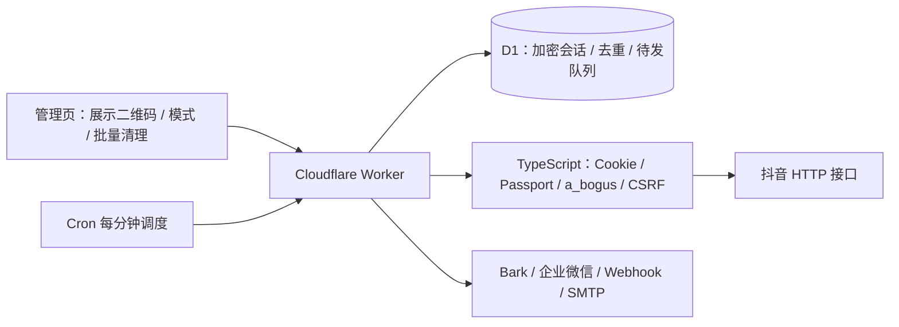

# 抖音推荐防误触

发现自己不小心点了「推荐」？这个工具定时读取**个人主页 → 推荐**，支持发消息提醒，也支持检测后自动取消。

**纯 Cloudflare 部署，无需自备服务器；也可在普通服务器或 Docker 中运行。中文界面、中文文档，MIT 开源。**

> v0.2 正在验证纯协议实现，尚未完成真实账号登录、推荐读取和取消的整体验收。早期手机确认后仍返回拒绝/限流；现已补齐匿名设备注册、P-256 登录凭证、会话令牌及动态环境校验，Node 真实前置流程已通过。31 项自动测试及 workerd + D1 测试已通过，但后者使用模拟抖音响应，不能替代真实账号验证。请勿把当前版本视为已验证可长期运行。

## 两种工作模式

| 模式                    | 行为                                           | 适用场景                     |
| ----------------------- | ---------------------------------------------- | ---------------------------- |
| 仅提醒 `notify`（默认） | 发现新增推荐，发送消息，保留推荐记录           | 希望自己判断是否误触         |
| 自动取消 `auto_cancel`  | 每轮发现推荐就尝试取消，并通过推荐列表接口复核 | 希望清除已有及以后误触的推荐 |

- 管理页面可以切换模式和检测间隔，设置保存在数据库，重启不丢失。
- 默认每 **300 秒**检测，最少 **60 秒**。这是轮询，不能监听手机点击瞬间；“立即取消”指检测到之后立即处理。调度对齐、网络耗时、失败退避和单批上限会增加延迟。
- 首次运行会把已有推荐当作首次发现并提醒；之后同一条仍在列表中的推荐不会反复提醒。完整扫描确认移除后，再次推荐会产生新的提醒。
- 自动取消也会处理历史记录，每轮最多 5 条，剩余记录下轮继续。`IGNORE_IDS` 中的作品不提醒、不取消。
- “新增推荐”不等于“误触”，程序不推断用户意图。
- 另有**批量清理**：预览本批 → 确认取消 → 逐条核实。它不受当前工作模式影响。

## 纯协议架构



后端使用 HTTP、加密 API、QuickJS WebAssembly、D1 和 SMTP TCP socket。**不安装 Playwright、Chromium，不绑定 Cloudflare Browser Run，也不调用外置签名服务。** QuickJS 在隔离的 JavaScript 引擎中处理平台返回的登录环境脚本，不启动浏览器。服务器版本使用相同协议代码，存储换成 SQLite。管理页只展示官方接口返回的二维码，扫码确认仍需用户在抖音 App 中完成。

协议路径：

| 步骤         | 接口 / 实现                                                     |
| ------------ | --------------------------------------------------------------- |
| 登录前置校验 | 匿名设备注册、会话令牌、登录引导、凭证交换及 `/passport/web/challenge/` |
| 生成二维码   | `GET /passport/web/get_qrcode/`                                 |
| 检查扫码状态 | `POST /passport/web/check_qrconnect/`，跟随受限域名内的登录跳转 |
| 确认本人账号 | `GET /aweme/v1/web/user/profile/self/`                          |
| 读取推荐     | `GET /aweme/v1/web/familiar/recommend/feed/`，按游标分页        |
| 取消推荐     | `POST /aweme/v1/web/familiar/recommend/cancel`                  |

签名由本地 TypeScript 生成；先注册匿名设备、校验 `ttwid`，通过 P-256 / ECDH / HKDF / HMAC 交换登录凭证，并获取服务器签发的 `msToken`。私钥随会话加密保存，响应中的令牌轮换会写回 Cookie；每轮业务操作前刷新令牌。Cookie 按域名、路径和有效期管理。取消前获取 CSRF 凭证，表单为 `item_id=<作品ID>&source=0&type=2`；成功后重新读取完整推荐列表，确认该作品消失才记录成功。不会把「喜欢」接口当成推荐接口，也不会重放旧签名。

环境校验使用同一会话的页面 Cookie、设备指纹及 SDK 参数；平台返回的动态脚本在独立 QuickJS 上下文中运行，堆内存限制 32 MiB，另设指令、异步任务、脚本及输出大小限制。脚本不能调用宿主网络、文件系统或环境变量，也不接收账号 Cookie、管理员口令或加密密钥。二维码生成前校验失败就停止，不让用户扫描缺少前置状态的二维码。

签名、Passport 参数和环境档案参考 MIT 开源项目 [yunsur/douyin-mcp](https://github.com/yunsur/douyin-mcp/tree/7e90d139007f141cb7389aa509d8e6e67f7b5840/douyin)，固定来源与许可证见 [THIRD_PARTY_NOTICES.md](THIRD_PARTY_NOTICES.md)。这是针对本项目所需接口的 TypeScript 适配，没有移植上游 TLS 指纹实现。令牌报告和环境模拟采用上游的预设设备档案，不是用户 Safari 或其他浏览器的实际指纹。Worker 的出站网络与 Go 客户端不同，不能据上游的成功记录推断本项目适用于所有账号和地区。

## 方案一：纯 Cloudflare（推荐）

需要 Node.js 22.13+（建议 24 LTS）、一个可使用 Workers 与 D1 的 Cloudflare 账号。

### 1. 安装并创建数据库

```bash
git clone --branch feat/pure-protocol https://github.com/Tommyeth/douyin-unrecommend.git
cd douyin-unrecommend
npm ci
npx wrangler login
npx wrangler d1 create douyin-unrecommend
```

把命令返回的 `database_id` 填入 [wrangler.jsonc](wrangler.jsonc)，替换全零占位符，然后：

```bash
npm run db:migrate
```

### 2. 设置两个独立密钥

分别运行两次 `openssl rand -hex 32`，将结果妥善保存：

```bash
npx wrangler secret put ADMIN_TOKEN
npx wrangler secret put AUTH_SECRET
```

- `ADMIN_TOKEN`：进入管理页面、调用管理 API 的口令。
- `AUTH_SECRET`：AES-GCM 登录态加密密钥。与管理员口令不同，且至少 32 个字符。
- 更换 `AUTH_SECRET` 后需重新扫码。不要把密钥填进仓库中的 `wrangler.jsonc`。

### 3. 配置通知

从 [examples/notifications.json](examples/notifications.json) 选择需要的渠道，删除不用的项，替换你自己的参数。支持同时启用多个渠道，`name` 必须唯一。

```bash
npx wrangler secret put NOTIFICATIONS_JSON
```

粘贴整个 JSON 数组即可。不要把填写过密钥的通知配置提交到 Git。

### 4. 部署并扫码

```bash
npm run deploy
```

1. 打开部署返回的 `workers.dev` 或自定义域名。
2. 输入 `ADMIN_TOKEN`。
3. 点击「生成二维码」，用抖音 App 扫描**官方二维码**，在手机上确认登录。
4. 页面每 6 秒检查状态，确认登录后自动加密写入 D1，也可手动点击验证。
5. 点击「测试通知」，确认收得到消息。
6. 选择「仅提醒」或「自动取消」，设置检测间隔，保存。

无需一直开着管理页，Cron 会继续运行。二维码会话最长 3 分钟；二维码过期后重新生成。二维码接口也要求管理员口令，响应禁止缓存。

### Cloudflare 的实际限制

- 不产生 Browser Run 用量；费用来自 Workers 请求/CPU、D1 及对应通知服务，实际按账号计划和用量计算。不能保证免费套餐足够长期使用。
- 动态环境脚本和签名需要 CPU。Cloudflare [运行限制](https://developers.cloudflare.com/workers/platform/limits/)规定 Free 请求 CPU 预算为 10 ms；本项目不保证满足这一预算。纯 Cloudflare 不等于免费部署，长期运行需根据实例 CPU 指标选择套餐。
- [Cron](https://developers.cloudflare.com/workers/configuration/cron-triggers/) 每分钟唤醒一次，根据数据库中的 `next_poll` 判断是否到期；未到期不请求抖音。新 Cron 配置需要时间传播。
- 登录轮询遇到错误码 `7` 时按 10 / 20 / 40 / 60 秒退避，并在二维码会话过期时停止。退避状态存入 D1，Worker 重启不会绕过等待。若响应明确包含验证码字段，则提示额外验证；不会把普通错误一律显示为验证码。管理员 API 的 `loginDiagnostic` 仅保存错误码及验证字段是否存在，不保存验证码凭证或链接。
- 纯协议不等于不受平台限制。抖音可能限制数据中心出口、使签名失效或要求额外验证。遇到验证或协议错误会停止本轮操作并显示错误，不能保证完全无人值守。
- 每轮抖音操作设有 120 秒请求中止期限。失败后退避，最多退避到一小时（配置间隔更长时尊重配置）。没有读完全部页面，不会据此判定某条记录已移除。

## 方案二：服务器 / 本机

### Node.js

```bash
npm ci
cp .env.example .env
# 编辑 .env：替换两个独立随机密钥，填写 NOTIFICATIONS_JSON
npm run dev
```

打开 `http://127.0.0.1:8787`。服务端无需桌面环境或浏览器进程。

### Docker Compose

```bash
cp .env.example .env
# 编辑 .env，密钥与通知配置同上
docker compose up -d --build
docker compose logs -f
```

数据存储在 `./data`，容器重启后仍保留。默认只监听本机 `127.0.0.1:8787`；远程访问可使用 SSH 隧道：

```bash
ssh -L 8787:127.0.0.1:8787 your-server
```

或通过 HTTPS 反向代理访问。不要通过明文公网 HTTP 传输管理员口令。

## 通知渠道

| 类型      | 参数                                                 | 说明                                                            |
| --------- | ---------------------------------------------------- | --------------------------------------------------------------- |
| `bark`    | `url`、`key`                                         | JSON POST；官方示例 `https://api.day.app/push`，也支持自建 Bark |
| `wecom`   | `url`                                                | 企业微信群机器人完整 Webhook URL，检查 `errcode`                |
| `webhook` | `url`、可选 `token`                                  | JSON POST，可附加 `Authorization: Bearer …`                     |
| `smtp`    | `host`、`port`、`username`、`password`、`from`、`to` | 直接 SMTP，隐式 TLS **465**，AUTH LOGIN；密码通常是邮箱授权码   |

SMTP 在 Cloudflare 中使用 TCP socket，在服务器中使用 Node TLS。当前**不支持 25 或 STARTTLS 587**；Cloudflare 禁止出站 25 端口，465 仍取决于目标邮件服务的网络及认证策略。无需额外邮件中转。消息为 UTF-8 MIME，多个收件人写进 `to` 数组。

通用 Webhook 请求：

```json
{
  "id": "new:1234567890123456789:1",
  "kind": "new_recommendation",
  "title": "抖音发现新增推荐",
  "body": "检测到推荐记录，可能是误触，请核对。\n作品标题",
  "url": "https://www.douyin.com/video/1234567890123456789"
}
```

事件类型有 `new_recommendation`、`cancelled`、`error`、`test`。`Idempotency-Key` 请求头等于事件 `id`。失败消息保存在待发队列，指数退避重试；已投递的消息按渠道独立记录，保留 30 天。投递采用**至少一次**语义，网络中断时仍可能重复；自建 Webhook 接收端应按事件 ID 去重。通知内容包含作品标题与链接，只会发往你配置的渠道。

## 命令行批量操作

管理页之外，也可以用脚本访问实例。`.env` 中配置 `ADMIN_TOKEN`，远程实例另加 `SERVICE_URL=https://your-worker.workers.dev`：

```bash
node --env-file=.env scripts/client.mjs status
node --env-file=.env scripts/client.mjs poll
node --env-file=.env scripts/client.mjs preview
# 查看预览结果，再传入返回的 token：
node --env-file=.env scripts/client.mjs clear <预览返回的token>
```

预览令牌 10 分钟有效且仅使用一次，只会取消预览中包含且仍存在的作品。每批最多 `MAX_ACTIONS` 条，反复预览并执行可继续清理。

## 配置项

| 配置                    | 默认值   | 说明                                   |
| ----------------------- | -------- | -------------------------------------- |
| `MODE`                  | `notify` | 首次启动默认模式；管理页保存的设置优先 |
| `POLL_INTERVAL_SECONDS` | `300`    | 60–86400；管理页保存的设置优先         |
| `MAX_PAGES`             | `10`     | 单次最多读取页数，1–100                |
| `MAX_ACTIONS`           | `5`      | 一轮/一批最多取消数量，1–50            |
| `ACTION_DELAY_MS`       | `3000`   | 取消请求后到复核前的间隔，至少 1000    |
| `PAGE_TIMEOUT_MS`       | `20000`  | 单个 HTTP 请求超时（保留旧配置名）     |
| `IGNORE_IDS`            | 空       | 逗号分隔的保留作品 ID                  |
| `NOTIFICATIONS_JSON`    | `[]`     | 通知渠道数组；仅提醒模式至少需一个渠道 |

Cloudflare 的普通参数写入 `wrangler.jsonc` 的 `vars`，敏感参数使用 `wrangler secret put`。服务器使用 `.env` 或进程环境变量。

## 可靠性与边界

- 每个部署只管理**一个抖音账号**。账号指纹绑定到数据库，换号时拒绝操作；不同客户使用独立部署/数据库/密钥。本项目不是多租户 SaaS。
- 数据库租约阻止 Cron、手动检测与清理同时修改账号。
- 只读取本人推荐页，不下载视频，不取消喜欢，不修改关注/收藏。
- 自动取消只允许处理本轮推荐接口中确认的作品，调用单向取消接口后重新读取完整列表。不能确认移除就报错停止，不把 HTTP 200 当作取消成功。
- 网页接口和签名逻辑不是抖音开放平台承诺的稳定 API，可能变化。出现协议错误、验证要求或 `CANCEL_REJECTED` 时停止本轮操作并退避。
- 登录态可能过期，届时通知重新扫码。Worker 重新实例化后从加密存储恢复 Cookie 与签名计数；这不保证平台永久维持登录。v0.1 的浏览器登录态不直接兼容，升级后需重新扫码，并保留原 `AUTH_SECRET` 与数据库。
- 检测周期之间发生又撤销的推荐可能被漏过；不完整扫描时，对未看到的记录保持原状态。因此某些重新推荐的情况只能在后续完整扫描中识别。
- `/healthz` 只表示进程可用；运行是否正常请看管理页的最近成功时间、错误和待发送数量。

## 开发与验证

```bash
npm ci
npm run check
npm test
npm run test:worker
```

测试覆盖 SM3 / a_bogus / 指纹确定性向量、环境校验加密、QuickJS 异步与资源限制、宿主隔离、Cookie 隔离、登录跳转域名限制、分页、CSRF 取消与结果复核、未扫描作品拒绝、去重与重新推荐、账号隔离、并发锁、加密登录态恢复、四种通知协议、失败重试以及 API 鉴权。

`test:worker` 构建后在真实 workerd 运行时和本地 D1 中执行环境脚本 → 扫码 → 读取 → 取消 → 复核流程，上游抖音响应使用模拟数据，QuickJS WASM 实际执行。测试不登录或操作真实账号，也不向真实通知渠道发送消息。构建和部署脚本会从锁定版本的 npm 依赖复制 WASM 到忽略目录 `src/generated/`，无需另行下载二进制。

目录：`src/protocol/` HTTP 与签名；`src/douyin.ts` 抖音业务接口；`src/service.ts` 工作流；`src/store.ts` 持久化；`src/notify.ts` / `src/smtp.ts` 通知；`src/worker.ts` Cloudflare 入口；`src/server.ts` 服务器入口。

参考：[Cloudflare TCP sockets](https://developers.cloudflare.com/workers/runtime-apis/tcp-sockets/)、[Bark](https://bark.day.app/)、[企业微信机器人](https://developer.work.weixin.qq.com/document/path/91770)。

## 安全反馈

请勿在公开 Issue 中附带 Cookie、登录二维码、请求签名、Webhook 密钥或完整 HAR。提交兼容性问题时，提供已去除个人信息的错误码和运行环境。所有登录态、数据库、`.env`、`.dev.vars` 与运行截图都已加入忽略列表。

许可证：[MIT](LICENSE)。本项目与抖音/字节跳动无隶属关系。
