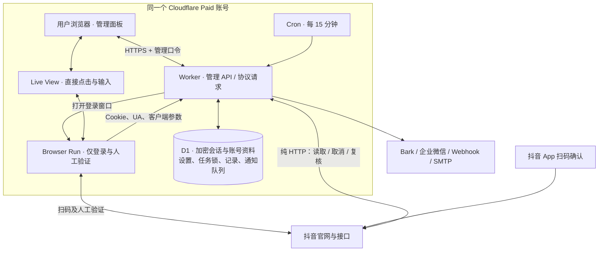

# Cloudflare Paid 混合版

扫码和人工验证使用 Browser Run 的真实 Chromium；日常读取、取消、结果复核由 Worker 的 `fetch` 完成。无需自备服务器，也不连接 Vercel。面板支持仅提醒和自动取消，默认每 15 分钟自动取消、不发通知。

已通过真实账号的 Browser Run 扫码、人工短信验证、Worker 纯协议读取及取消验收，详见 [验证记录](cloudflare-hybrid-verification.md)。Live View 在抖音页面的直接键鼠控制仍有兼容问题；短信验证可使用面板的备用输入栏。

## 部署结构



扫码后先关闭登录浏览器，再由 Worker 独立验证登录态和完整推荐列表。验证成功才保存为可用会话、允许定时任务处理。协议受限时保留加密候选会话，面板提供「重试纯协议验证」；不会偷偷启动浏览器执行日常任务。

## 首次部署

需要 Node.js 24、Workers Paid，以及同一账号的 Browser Run 和 D1 权限。网站 Pro 套餐与 Workers Paid 不是同一套餐。

```bash
npm ci
npx wrangler login
npx wrangler whoami
npx wrangler d1 create douyin-unrecommend-hybrid
```

编辑仓库根目录 `wrangler.hybrid.jsonc`：把 `d1_databases[0].database_id` 的全零占位值换成创建结果。多账号用户同时指定自己的 `account_id`；Worker、D1 和 Browser Run 必须属于同一账号。数据库和账号 ID 不是密钥，但不要把自己的部署配置提交回公共仓库。

分别运行两次 `openssl rand -hex 32`，生成不同的管理员口令和加密密钥，并备份。按 CLI 提示分别输入：

```bash
npx wrangler d1 migrations apply douyin-unrecommend-hybrid --remote --config wrangler.hybrid.jsonc
npx wrangler secret put ADMIN_TOKEN --config wrangler.hybrid.jsonc
npx wrangler secret put AUTH_SECRET --config wrangler.hybrid.jsonc
npm run deploy:hybrid
```

`ADMIN_TOKEN` 用于连接面板；`AUTH_SECRET` 加密会话、账号资料和临时浏览器会话编号。丢失加密密钥后需重新扫码。默认配置：

```json
{
  "MODE": "auto_cancel",
  "POLL_INTERVAL_SECONDS": "900",
  "NOTIFICATIONS_JSON": "[]",
  "MAX_ACTIONS": "5"
}
```

`*/15 * * * *` 每 15 分钟触发。面板允许 900 秒的整数倍；失败时会退避，实际处理可能晚于所选间隔。已有面板设置保存在 D1，优先于环境变量默认值。

## 扫码和人工验证

1. 打开部署的 `workers.dev` 地址，输入 `ADMIN_TOKEN`。
2. 点击「打开登录浏览器」，再点击「进入抖音登录窗口」。
3. 用抖音 App 扫码。遇到短信、安全验证时，在 Live View 内直接点击和输入，由本人完成。
4. 返回面板，等候自动检查，或点击「检查扫码结果」。只有显示协议验证通过，才完成整个登录过程。

登录窗口最长约 10 分钟；关闭面板不一定立即关闭远端浏览器，可以点「取消登录」主动结束。过期窗口由后续请求或调度清理，浏览器也有空闲超时。Live View 链接是临时访问凭证，不要截图分享完整地址。链接过期但浏览器仍在运行时，再点「打开登录浏览器」可获取新链接并继续原会话。

实测中抖音验证页可能显示正常却不能接收原生鼠标或键盘输入，新建标签页也可能复现。此时使用辅助短信验证；不能仅凭画面出现判断直接控制已通过验收。

这是 [Cloudflare Live View](https://developers.cloudflare.com/browser-run/features/live-view/) 原生交互窗口，官方提供直接键鼠控制能力，但本次抖音页面未通过这项交互验收。项目不需要另外安装 noVNC。若远端画面不能点击或键入，可展开面板的「辅助短信验证」，选择接收短信、重新发送或填入验证码后提交；仅此备用入口会经管理 API 转发验证码，内容不写入日志或数据库。验证码由用户本人填写，项目不自动处理验证码答案。

账号头像和昵称在扫码时从自己的主页保存；「核对账号」只通过协议重新确认绑定身份和确认时间，不更新头像与昵称。协议任务使用绑定账号核对身份，不能保证登录态长期有效；出现失效、验证或平台限制时停止并在面板显示原因。

## 通知和两种模式

- **仅提醒**：保留推荐，只对新发现的记录发送消息。必须配置至少一个渠道。
- **自动取消**：处理已有和新增推荐，每轮默认最多 5 条，可以不配置通知。

参考 [通知配置示例](../examples/notifications.json)。包含设备 Key、机器人地址或 SMTP 密码的配置应写入 Secret：

```bash
npx wrangler secret put NOTIFICATIONS_JSON --config wrangler.hybrid.jsonc
```

配置通知时先从 `wrangler.hybrid.jsonc` 的 `vars` 中删除同名 `NOTIFICATIONS_JSON`，再部署并写入 Secret，避免同名变量冲突。SMTP 使用隐式 TLS 465，不支持 25 或 STARTTLS 587。可以通过面板「测试通知」检查投递。

## 资源与套餐

本架构使用 Worker、Cron、D1、Browser Run；不需要 KV、R2、Durable Objects 或外部数据库。Browser Run 只在扫码和人工验证期间运行，空闲等待扫码也计入浏览器时长。

**是否免费：否，需要 Workers Paid。** 浏览器及其他资源超出套餐额度时另计用量。15 分钟周期在 31 天约触发 2976 次；每轮分页、取消后的复核及通知会产生额外请求和数据库操作。

Browser Run 登录成功不意味着协议请求一定获准：两条路径的出口 IP、TLS 和运行环境不同。浏览器保存的 Cookie、UA、参数和签名只能满足部分请求条件，不能保证规避平台限制。项目不会把空响应或错误响应当成「推荐列表为空」。

## 验收与排查

本地运行：

```bash
npm run check
npm test
npm run test:hybrid
```

`test:hybrid` 使用真实 workerd + D1、本地模拟抖音接口，验证候选会话解密、协议读取、CSRF 取消、完整列表复核，并断言浏览器绑定调用次数为零。

真实部署还需要确认：

- 从 Browser Run 的真实二维码完成登录，面板确认是预期账号。
- 关闭浏览器后，Worker 能独立读取完整推荐列表。
- 对自己授权的推荐执行取消，随后完整列表确认该作品消失。
- 再次请求和定时触发可恢复加密会话；日常任务期间浏览器启动次数不增加。
- 提醒模式不发出取消请求；通知渠道的实际连通性另行测试。

`/api/status`（需要管理口令）返回最近协议阶段、HTTP 状态、错误码和最近一次 Cron 执行记录，不返回 Cookie 或签名。`/api/runtime` 返回 Browser Run 当前配额。部署错误 `100328` 表示当前账号仍是 Workers Free，需切换到正确的 Paid 账号。

部署入口为 `src/hybrid/worker.ts`，配置文件为 `wrangler.hybrid.jsonc`。
