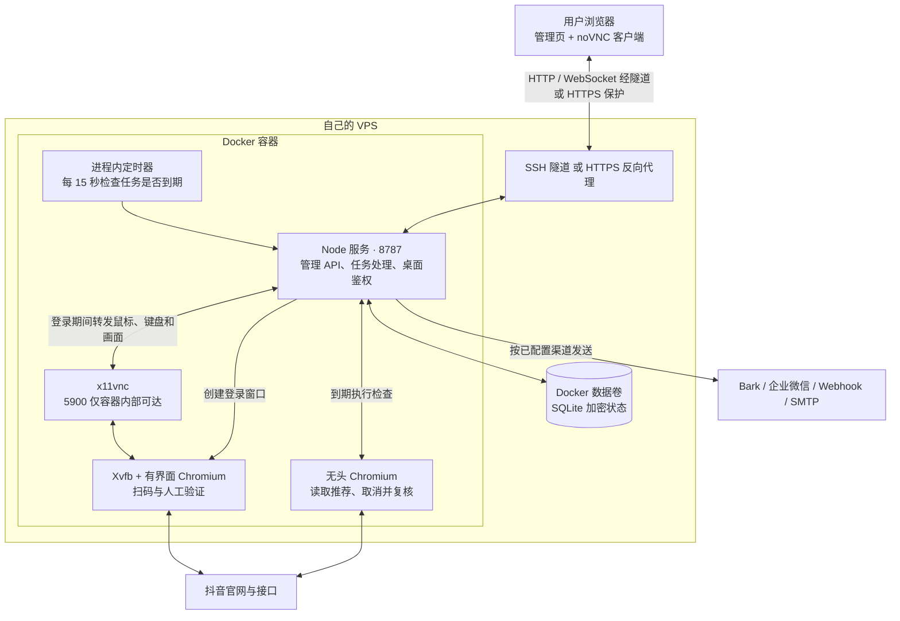

# VPS Docker 部署

自备 Linux VPS，使用真实 Chromium 处理登录和日常任务；内置 noVNC，可直接操作远端浏览器。项目无软件订阅费，费用取决于 VPS、存储和流量；已有服务器可复用。

容器集成测试已覆盖真实 Chromium、noVNC 输入和模拟登录。具体 VPS 的抖音网络与真实账号仍需自行验收；这次 Vercel 的纯协议改造不改变 Docker 执行方式。

## 部署架构



noVNC 的键盘和鼠标操作直接进入容器里的 Chromium，登录窗口最长 15 分钟；日常检查使用无头浏览器，最短间隔 300 秒。登录成功后，无需保持管理页打开。

## 安装

使用能运行 Docker Engine + Compose 的 Linux VPS。建议至少 2 GB 可用内存；实际占用随抖音页面变化。首次构建会下载 Chromium 和中文字体。

```bash
git clone https://github.com/Tommyeth/douyin-unrecommend.git
cd douyin-unrecommend
cp .env.example .env
openssl rand -hex 32
openssl rand -hex 32
```

编辑 `.env`，把两个不同的随机值分别填入 `ADMIN_TOKEN`、`AUTH_SECRET`。若希望每 5 分钟自动取消且暂不通知：

```dotenv
MODE=auto_cancel
POLL_INTERVAL_SECONDS=300
NOTIFICATIONS_JSON=[]
```

保留其他参数的默认值，然后启动：

```bash
docker compose up -d --build
docker compose logs -f --tail=100
```

默认只监听 VPS 的 `127.0.0.1:8787`。在自己电脑执行 SSH 隧道：

```bash
ssh -N -L 8787:127.0.0.1:8787 user@your-vps
```

在本地打开 `http://127.0.0.1:8787`，输入 `ADMIN_TOKEN` 即可。若改用域名访问，配置 HTTPS 反向代理并设置 `.env` 中的 `PUBLIC_ORIGIN=https://douyin.example.com`，重建容器；代理需支持 WebSocket 和流式响应，见 [Nginx 示例](../examples/nginx.conf)。

## 直接控制 Chromium

1. 点击「打开登录浏览器」。页面自动连接 noVNC，显示容器里的完整 Chromium 窗口。
2. 用抖音 App 扫码。出现验证时，**直接在浏览器画面里点击、键入、按 Enter 或拖动**，由你本人完成。
3. 登录窗口最长 15 分钟；成功保存后关闭浏览器并撤销桌面连接。之后不必保持面板打开。
4. 连接中断可点击「重新连接桌面」。截图及文字输入栏仍可备用；中文输入法或移动设备键盘不兼容时，可使用文字输入栏。

容器内运行 Xvfb、Chromium、x11vnc 和 Node 服务；noVNC 客户端随项目打包。VNC 的 5900 端口仅绑定容器内部回环地址，**不需要开放 5900 或 6080**。WebSocket 通过面板同源入口连接，要求管理口令换取的 HttpOnly 会话 Cookie，绑定当前登录窗口；结束后撤销。日常检测使用无头 Chromium，不开放桌面。

Docker 检查间隔支持 **300–86400 秒，按 60 秒递增**，例如 300、600、900、3600。后台每 15 秒检查到期任务，不依赖浏览器页面或外部 Cron。

## 保存、更新与备份

设置、加密登录态、去重记录和通知队列保存在 Compose 的 `douyin-data` 数据卷，普通重启或重新构建不会丢失。面板保存的模式和间隔优先于 `.env` 默认值；修改 `.env` 后不要误以为覆盖了已保存设置。

```bash
# 更新代码和镜像
git pull --ff-only
docker compose up -d --build

# 查看状态与重启
docker compose ps
docker compose restart

# 备份：暂停写入后复制整个数据目录（含 SQLite WAL）
docker compose stop
mkdir -p backup
docker compose cp douyin:/app/data ./backup/
docker compose start
```

同时备份 `.env` 中的 `AUTH_SECRET`；不要把备份提交到公开仓库。`docker compose down` 保留数据，`down -v` 会删除数据卷。旧纯协议 SQLite 不会自动迁移，切换 Chromium 版后重新扫码。

通知和保留名单见 [配置说明](configuration.md)，开发与容器验收见 [开发说明](development.md)。返回 [方案对比](../README.md)。
