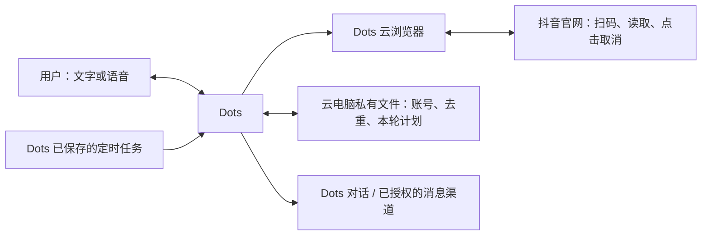

# Dots 云浏览器直控版

由 Dot 自己的云浏览器打开抖音官网，读取和点击「取消推荐」。不需要 Vercel、Docker、Cloudflare 或单独的 MCP 服务。登录态留在云浏览器，账号绑定及去重记录保存在云电脑的私有文件中。

**本版为实验工作流**：已实现技能包、两种模式、状态脚本和自动化测试；尚未完成真实 Dots 云端扫码、取消及定时验收。当前开发聊天没有连接用户的 Dot 云浏览器，不会把本机 Chrome 的结果当成 Dots 验收。



## 开始使用

无需在用户本机安装浏览器或登录项目面板。把下面这段发给**你自己的 Dot 对话**，让工作实际发生在它的云电脑上：

```text
请使用你的云电脑和云浏览器，按这个开源技能管理我的抖音推荐：
https://github.com/Tommyeth/douyin-unrecommend/blob/main/plugins/douyin-dots/skills/douyin-direct/SKILL.md

请读取完整技能及它引用的 references.md、scripts/state.py，将本次使用的版本保存在云电脑。
先确认你有云浏览器、Python 3 和可保存状态的私有目录。
打开抖音本人的「推荐」页，让我接管云电脑扫码和完成验证；归还后核对抖音号。
先做一轮只读验收，报告账号、完整性和推荐数量。先不要创建定时任务或取消作品。
不要调用现有 Vercel/Docker 后台，也不要使用我本机的浏览器。
```

这个入口是直接让 Dot 读取并执行工作流，**不是**宣称插件已经安装到账号。若云端不能读取 GitHub，可将下面生成的技能包作为附件提供给 Dot 或工作空间可用的 Plugin Creator；安装/导入方式取决于账号所在界面，不能用本机复制技能替代云端安装。

```sh
npm run build:dots
```

产物为 `dist/douyin-dots-0.1.0.zip`，含标准 `plugin.json`、中文技能、状态脚本和许可证。未提交或发布到 OpenAI 公共插件目录。插件格式参照 [官方打包说明](https://developers.openai.com/plugins/build/plugins)。

## 两种模式

只读验收后，可以给 Dot 下列指令；模式、频率和通知都以你的实际选择为准。

**仅提醒新增**：

```text
使用 notify 模式，首次完整列表作为基线，以后发现新增推荐就在本 Dots 对话提醒我。
保留推荐，不要取消。请设置每 15 分钟检查一次，时区 Australia/Sydney。
先确认你的调度功能实际支持该频率，保存后给我任务 ID 和下一次执行时间。
```

**自动取消**：

```text
使用 auto_cancel 模式，自动取消这个已绑定账号的已有及新增推荐，每轮最多 5 条。
每条操作后回个人推荐列表完整复核，不操作「喜欢」「收藏」。
请设置每 15 分钟检查一次，时区 Australia/Sydney；暂不发送例行通知。
需要扫码或人工验证时告诉我。保存后确认实际调度和下一次执行时间。
```

Dots 支持保存重复任务，但实际频率和可用工具需在目标账号确认。状态脚本不创建任务，浏览器一直开着也不等于定时生效。[官方任务说明](https://learn.chatgpt.com/docs/dots/tasks-and-memory)

## 日常控制

- 「现在检查一次，不取消」：单次只读；不改变长期模式。
- 「暂停这个抖音任务」：暂停宿主调度并设置本地暂停标记。
- 「恢复检查，改为每小时」：更新实际调度，核对原账号后恢复。
- 「切换仅提醒」或「切换自动取消」：更新模式并使旧的本轮计划失效。
- 「保留这几个作品」：将明确作品 ID 加入保留名单。
- 「汇报最近结果」：说明最后读取时间、完整性、已经验证的取消数和失败原因。

直接向 Dot 发起语音通话也可下指令或听取结果；主动外呼不属于本项目功能。本版不自动接入后台版的 Bark、企微、Webhook、SMTP。[Dots 消息与语音](https://learn.chatgpt.com/docs/dots/channels)

## 扫码和迁移

Dot 的云浏览器有独立登录态。打开它的云电脑，选择 **Take over / 接管**，在官方页面扫码、输入短信或完成安全验证，再归还控制。验证码不要发在聊天中，项目不导出 Cookie。[官方云电脑说明](https://learn.chatgpt.com/docs/dots/computers-and-apps)

原有 Vercel/Docker 定时任务不会因增加这个包而停止。迁移时先在 Dot 完成下面验收，再按你的选择停旧执行器，避免两个任务操作同一账号：

1. 云浏览器扫码并确认是指定的本人账号。
2. 完整读取推荐列表；空白、加载中和部分读取不算零条。
3. 用一条你指定的推荐测试取消，确认未推荐状态及完整列表已移除。
4. 从保存的定时任务启动第二轮，验证能恢复账号状态与去重记录。
5. 暂停后确认调度真的停止，再决定是否替换旧部署。

## 开发验证

```sh
python3 tests/dots_state_test.py
npm run build:dots
```

测试使用虚构账号和作品，覆盖：首次基线、重复提醒、再次推荐、部分读取、保留名单、每轮数量限制、未复核拒绝确认、账号变化、模式变化使旧计划失效、重叠任务、暂停/过期、文件写锁和私有文件权限。它们验证状态逻辑，不证明 Dots 云网络能访问抖音，也不替代真实网页操作验收。
