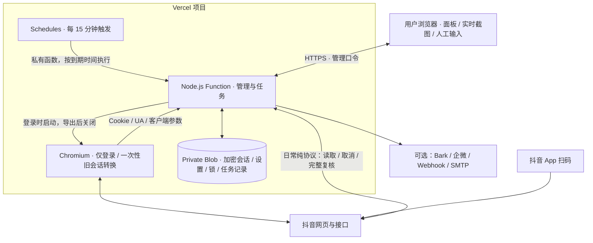

# Vercel 混合版部署

扫码与人工验证使用真实 Chromium；日常读取、提醒、取消和复核使用 Node.js `fetch`。无需自备服务器，登录态和记录保存在 Vercel Private Blob；不依赖 Cloudflare。一个部署管理一个账号。

本版保留 Chromium 依赖用于登录，但日常任务不启动它。协议受限时会停止并记录错误，不自动回退浏览器。真实验收见 [Vercel 验证记录](vercel-hybrid-verification.md)。

## 部署架构



每次函数调用从加密 Blob 恢复状态。操作前通过 ETag 条件写取得租约，结束后保存结果，避免并发任务覆盖。未到期的调度只读、不写状态。浏览器结束后不会常驻；无需保持面板打开。

## 首次部署

需要 Node.js 24 和自己的 Vercel 账号。网页、登录浏览器、协议任务和状态全部位于 Vercel；无需 Cloudflare、外置数据库或服务器。

```bash
git clone https://github.com/Tommyeth/douyin-unrecommend.git
cd douyin-unrecommend
npm ci
npx vercel@65.16.0 login
npx vercel@65.16.0 link
npx vercel@65.16.0 blob create-store douyin-private \
  --access private --region hnd1 --yes --environment production
```

分别运行两次 `openssl rand -hex 32` 生成两个不同的密钥，妥善备份，然后按 CLI 提示输入：

```bash
npx vercel@65.16.0 env add ADMIN_TOKEN production --sensitive
npx vercel@65.16.0 env add AUTH_SECRET production --sensitive
```

- `ADMIN_TOKEN` 是面板管理口令，只保留在当前页面内存，刷新后重新输入。
- `AUTH_SECRET` 加密登录态和任务记录；丢失后无法恢复原状态。
- Blob 必须选择 **Private**。创建并关联项目后，CLI 自动配置其凭证。

需要提醒时，参照 [通知示例](../examples/notifications.json) 配置自己的渠道，把 JSON 数组粘贴到敏感环境变量；只用自动取消可省略：

```bash
npx vercel@65.16.0 env add NOTIFICATIONS_JSON production --sensitive
npx vercel@65.16.0 deploy --prod
npx vercel@65.16.0 schedules list
```

调度 `douyin-hourly` 应为 active，表达式 **`*/15 * * * *`**，目标是私有函数 `api/hourly`。名称为兼容旧部署而保留；它每 15 分钟检查是否到期，实际读取抖音的间隔由面板决定，默认仍为一小时。未到期时只读状态，不启动 Chromium、不写 Blob。

## 调整 Vercel 间隔

默认可在面板选择 900、1800、3600 等秒数，以 900 秒递增，上限 86400 秒。旧版 3600 秒下限是项目配置，并非抖音要求。

Vercel Hobby 的 [Schedules 最短间隔为 15 分钟](https://vercel.com/docs/schedules/limits)，固定 15 分钟调度窗口。若使用支持 5 分钟调度的付费计划：

```bash
npm run schedule:vercel -- 300
npx vercel@65.16.0 deploy --prod
```

脚本同步修改调度表达式和面板/API 的间隔限制，部署后再在面板保存 300 秒。恢复免费版兼容配置用 `npm run schedule:vercel -- 900` 后重新部署。项目不会自动变更套餐。

## Vercel 扫码输入

打开部署域名，输入管理口令，点击「生成 / 重新生成二维码」，用抖音 App 扫描页面里的实时二维码。

画面是远端 Chromium 的**截图**，不是本地浏览器窗口，所以不能直接在图片上键入。出现验证时：

1. 点击画面里的选项或输入框；必要时放大画面。
2. 显示「已选中远端输入框」后，在下方文字栏填写，点击「输入并确认」。若 Enter 无效，手动点击画面中的验证按钮。
3. 完成后等待保存；必要时点击「检查登录结果」。浏览器关闭后，函数会独立读取账号和完整推荐列表，协议验证与加密保存均成功才显示已登录。

输入只用于转发当前人工操作，不写日志，消费后从临时队列删除；每次会话最多 40 项操作。窗口约 4 分钟，倒计时结束会关闭。图片约每秒更新一次，响应速度受网络和 Blob 读写影响。**Vercel 版不提供 noVNC 常驻 WebSocket 桌面**；需要完整鼠标键盘操作时使用 Docker 版。

## Vercel 额度

截至 2026-11-16，Hobby [Functions](https://vercel.com/docs/functions/limitations) 单次最多 300 秒，2 GB / 1 vCPU；[Schedules](https://vercel.com/docs/schedules/limits) 每周期最多 5000 次，仍为 Beta。

默认调度每 15 分钟触发，31 天为 2976 次；若实际每小时检测，最多约 744 轮协议任务、约 1488 次 Blob 写入。若改成每 15 分钟实际检测，则约 5952 次写入，超过 [Blob 免费高级操作额度](https://vercel.com/docs/vercel-blob/usage-and-pricing)。扫码、人工操作、设置、流量和计算也有额外用量；可选间隔不等于能保证落在免费额度内。

[Vercel Hobby](https://vercel.com/pricing) 面向个人、非商业用途；客户商业托管请按适用套餐部署。

## 从旧 Vercel 版升级

更新代码并重新部署，管理员口令和 `AUTH_SECRET` 保持原值。面板会识别原来的 Chromium 会话：

1. 点击「转换已有登录态」。仅这一步短暂恢复一次浏览器，导出协议需要的 Cookie、UA 和客户端参数后关闭。
2. Node.js 函数单独读取账号和完整推荐列表；通过后才替换旧会话并启用任务。
3. 若协议验证失败，原会话仍保留，候选会话也加密保存。点击「重试纯协议验证」不会重新启动浏览器。
4. 旧会话已失效时需要重新扫码。安全验证仍需本人完成。

面板显示协议状态和浏览器启动次数。转换前或候选会话待验证时，定时任务跳过；预览和取消也不能使用未验证会话。`browserStarts` 从这版起计数，不包含历史版本。

登录头像、昵称在登录或转换时缓存；「核对账号」通过协议确认身份，不下载新头像。调用 `/api/status` 可检查 `runtime=vercel-hybrid`、`execution=node-fetch`、`protocolDiagnostic`、`scheduleDiagnostic`，需要管理口令；不返回 Cookie 或签名。

## 验收与故障

先用面板预览完整推荐列表，确认账号正确；再用自己授权的一条推荐执行取消，检查复核结果。重新请求及调度执行后，浏览器启动次数应保持不变。提醒模式必须配置通知渠道；自动取消可以设置 `NOTIFICATIONS_JSON=[]`。

空响应、接口错误、账号不一致都不会被当作零条推荐。会话失效或接口变化可能需要重新扫码或更新项目，不能保证永久免验证。部署步骤成功不等于该账号的抖音登录成功。

返回 [方案对比](../README.md) · [通知与工作模式](configuration.md) · [开发说明](development.md)。
